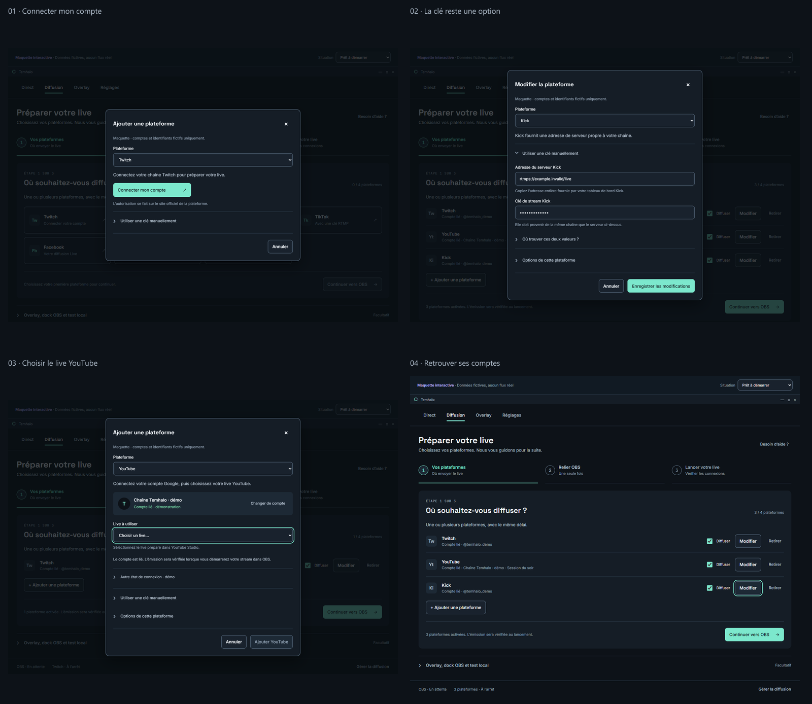

# Temhalo

Votre live. Votre tempo.

[Site de présentation et guide rapide](https://zeeroz.github.io/Temhalo/) · [Télécharger Temhalo](https://zeeroz.github.io/Temhalo/#telecharger)

Le site propose automatiquement la dernière version complète, previews comprises, après publication sur GitHub. [Fonctionnement du site et du déploiement](website/README.md).

Temhalo est une application Windows open source qui permet d’ajuster le délai d’un stream OBS en direct, de 0 à 300 secondes. Le flux H.264/AAC est relayé sans réencodage vers Twitch, YouTube, Kick ou un serveur RTMP/RTMPS, avec jusqu’à quatre destinations partageant le même délai.



## Installer

Téléchargez l’installeur **Temhalo-…-Setup-x64.exe** dans les [releases officielles](https://github.com/Zeeroz/Temhalo/releases). Il installe Temhalo pour votre compte, avec des raccourcis Bureau et menu Démarrer. Windows 10 version 1809 ou ultérieure / Windows 11, en x64, est requis. Les runtimes .NET, ASP.NET Core et WinUI sont inclus. Aucun logiciel payant n’est nécessaire.

La première version publique est une **preview**. Les exécutables ne sont pas encore signés Authenticode. Les empreintes SHA-256 sont publiées avec chaque livraison. MediaMTX et FFmpeg sont téléchargés depuis leurs projets amont et vérifiés au premier démarrage du relais ; cette préparation nécessite Internet.

Un ZIP portable autonome est également disponible. Les réglages et comptes sont conservés sous `%LOCALAPPDATA%\Temhalo`, chiffrés pour le compte Windows courant avec DPAPI. Une désinstallation retire les fichiers de l’application et ses raccourcis, en conservant ce profil pour une éventuelle réinstallation.

## Premier live

1. Dans **Diffusion**, ajoutez vos plateformes avec une clé manuelle, ou connectez un compte si la configuration OAuth est activée.
2. Dans OBS → Paramètres → Stream, choisissez **Personnalisé**, serveur `rtmp://127.0.0.1:1935/live`, clé locale `stream`.
3. Réglez OBS sur H.264 + AAC, débit CBR et intervalle d’images clés de **1 seconde**. Désactivez le délai de stream propre à OBS.
4. Démarrez le relais dans Temhalo, puis la diffusion dans OBS.
5. Dans **Direct**, appliquez un preset ou une valeur de 0 à 300 secondes. Une seule page Réglages regroupe les mises à jour, le Stream Deck, la mémoire et les journaux.

[Guide rapide](docs/DEMARRAGE-RAPIDE.md) : plateformes, OBS, commandes du délai et Stream Deck.

La connexion Twitch utilise l'identifiant public de l'application Temhalo intégré aux sources ; aucun fichier personnel ni secret Twitch n'est nécessaire sur un autre PC. YouTube et Kick nécessitent encore leur configuration développeur : [guide des comptes](docs/COMPTES-OAUTH.md). Les jetons et clés des utilisateurs ne sont jamais fournis dans le dépôt. Les clés manuelles restent utilisables sans broker. Kick nécessite un broker hébergé pour conserver son secret côté serveur ; ses sources sont dans `services/Temhalo.AccountBroker`.

Les pages Vos commandes et Confidentialité, les raccourcis clavier globaux, les presets personnalisables, le dock OBS et le test local ont été retirés. Les commandes 0/15/30/60 s et la saisie jusqu’à 300 s restent sur Direct ; les touches se règlent dans Stream Deck.

## Mises à jour

Dans **Réglages → Au quotidien → Mises à jour**, recherchez, téléchargez puis installez une nouvelle version après l’arrêt du relais. La recherche au démarrage et les versions de test peuvent être désactivées. Le téléchargement vérifie la taille et le SHA-256 fournis par GitHub ; l’intégrité est vérifiée de nouveau avant de lancer l’installeur.

L’installation conserve les comptes, clés et réglages. Une copie portable ou de développement ne remplace jamais automatiquement son dossier. Voir [la procédure utilisateur, les tests et la publication d’une version](docs/MISES-A-JOUR.md).

Pour publier vos changements depuis les sources, lancez `./Publier-Temhalo.ps1` dans PowerShell 7 et choisissez le numéro de version. Le script prend en charge les tests, les livrables, le commit, le tag et le suivi de la publication GitHub. `./Publier-Temhalo.ps1 -Version 0.7.0-preview.3 -WhatIf` permet de voir le parcours sans publier.

## Stream Deck

Le plugin Stream Deck facultatif fournit neuf actions : démarrage/arrêt du relais, protection, direct 0 s, preset, ajout/retrait du délai, affichage du délai mesuré, état OBS/sorties et réglage à la molette pour Stream Deck +. Depuis `0.7.0-preview.4`, le plugin se connecte automatiquement à l'application par un canal Windows dédié, avec les états poussés par Temhalo. Aucun dock OBS n'est nécessaire. Mettez à jour l'application et le plugin ensemble ; `0.7.0-preview.3` utilise encore la liaison HTTP. [Installation, actions et procédure de test](plugins/streamdeck/README.md).

Pour le construire ou produire les paquets Windows depuis les sources, installez aussi Node.js 24 et pnpm 11.25.0. `./tools/Build-StreamDeck.ps1` construit, teste, valide et emballe le plugin sans modifier vos profils Stream Deck. Ces outils ne sont pas nécessaires aux utilisateurs du paquet précompilé.

## Fonctionnement et limites

```text
OBS → RTMP local → MediaMTX → FFmpeg lecteur (-c copy)
    → moteur C# : FLV, buffer RAM, délai et timestamps
    → un FFmpeg émetteur (-c copy) par destination → RTMP/RTMPS
```

Augmenter le délai crée des pauses par paliers ; le lecteur de la plateforme peut afficher un gel ou du buffering, et une plateforme peut couper une connexion trop longtemps inactive. Réduire le délai saute vers une image clé. Le mode fluide avec réencodage n’est pas implémenté. Le délai affiché mesure le moteur ; la latence d’OBS, du réseau et du lecteur s’ajoute. La cible 0 s n’implique pas une latence totale nulle.

Le buffer conserve au maximum la limite RAM configurée (512 MiB par défaut). Cinq minutes à 8 Mbit/s représentent environ 300 Mo de média, auxquels s’ajoutent les structures du moteur. Les reconnexions ne peuvent récupérer que les données encore retenues. [Architecture et limites détaillées](docs/ARCHITECTURE.md).

## Compiler et tester

Prérequis : Windows x64, PowerShell 7, Git, SDK .NET **10.0.401** (`global.json`), runtimes .NET 8 et ASP.NET Core 8 x64 pour les tests. Le produit cible **.NET 8 / C# 12 / WinUI 3**. Les dépendances sont centralisées et verrouillées ; la compilation en ligne de commande n’exige pas Visual Studio payant.

```powershell
git clone https://github.com/Zeeroz/Temhalo.git
cd Temhalo
dotnet restore Temhalo.sln -p:Platform=x64 --locked-mode
dotnet build Temhalo.sln -c Release -p:Platform=x64 --no-restore
dotnet test Temhalo.sln -c Release -p:Platform=x64 --no-build --no-restore
./tools/Start-Temhalo.ps1 -Configuration Release
```

La préparation manuelle des outils média s’effectue avec `./tools/native/Get-NativeTools.ps1`. Les tests unitaires ne nécessitent aucun compte ni publication de live. Les essais natifs et d’endurance se lancent séparément, avec des destinations locales, selon les guides dans `docs/`.

```powershell
./tools/Package-Windows.ps1
./tools/Build-Installer.ps1
./tools/Test-Installer.ps1
```

Les livrables vont dans `artifacts/packages`. Le workflow Windows vérifie les pull requests et publie une release lorsqu’un tag correspondant à `Directory.Build.props` est poussé. Le guide [MISES-A-JOUR.md](docs/MISES-A-JOUR.md) explique la préparation de l’inventaire de désinstallation et les étapes de publication.

## Organisation

| Dossier | Contenu |
| --- | --- |
| `src/Temhalo.Core` | Parseur FLV, buffer et délai dynamique sans UI |
| `src/Temhalo.Infrastructure.Windows` | Processus, comptes, DPAPI, serveur local et mises à jour |
| `src/Temhalo.Presentation` | Modèles de présentation testables |
| `src/Temhalo.App` | Interface WinUI 3 |
| `src/Temhalo.RelayHost` | Relais console pour essais locaux |
| `services/Temhalo.AccountBroker` | Broker OAuth Kick à héberger |
| `tests/` | Tests unitaires et outils de validation Windows |
| `config/`, `packaging/`, `tools/` | Configuration publique, NSIS et scripts |
| `assets/brand/`, `design/`, `BRAND.md` | Identité visuelle, icônes, polices et maquettes |
| `docs/` | Architecture, procédures et validations historiques |

Les rapports historiques décrivent les versions testées à leur date ; ils ne remplacent pas une validation de la dernière release. Les archives de travail, journaux, binaires compilés et configurations personnelles restent hors de Git.

## Contribuer et licences

Le code propre de Temhalo est sous [licence MIT](LICENSE). Les composants tiers conservent leurs licences : [notices](packaging/THIRD-PARTY-NOTICES.md), [dépendances média](docs/DEPENDANCES.md), notices OFL des polices dans `assets/brand/fonts/licenses`. L’identité de Temhalo est décrite dans [BRAND.md](BRAND.md).

Lisez [CONTRIBUTING.md](CONTRIBUTING.md) avant une pull request et [SECURITY.md](SECURITY.md) pour un signalement sensible. N’ajoutez jamais de clé, fichier DPAPI, jeton OAuth ou lien privé dans une issue ou dans Git.
